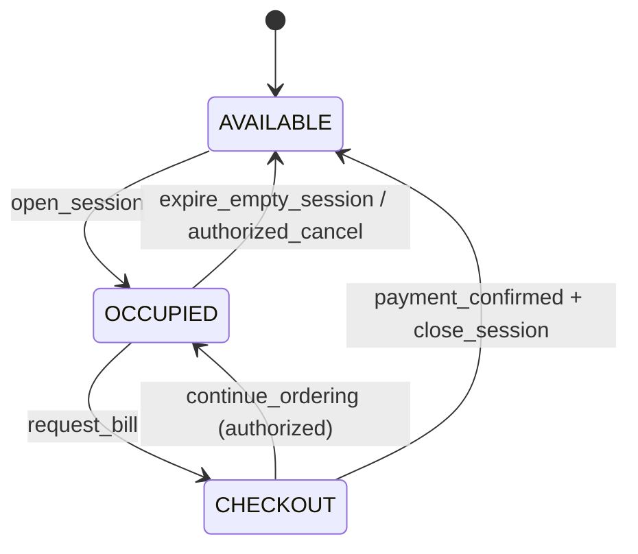
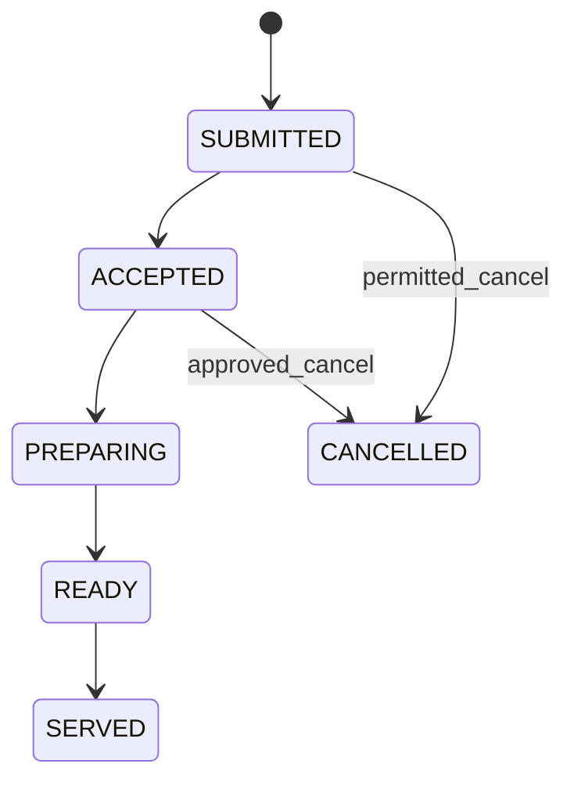
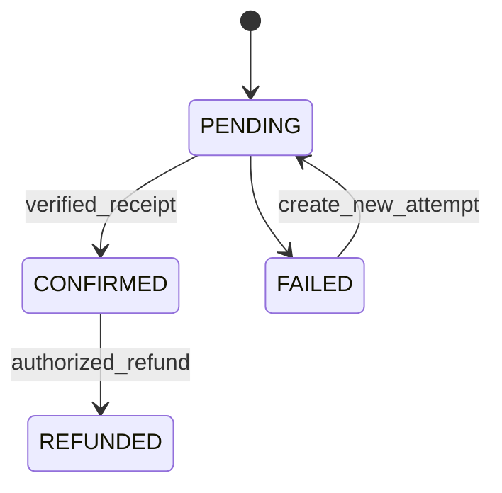

# DINEFLOW — ĐẶC TẢ WEB & QUY TRÌNH NGHIỆP VỤ CHO NHÓM (PHP 8.2 THUẦN + MYSQL 8.0 + DOCKER)

> **Phiên bản:** 1.1 — Tài liệu Đặc tả Kỹ thuật & Đối chiếu Kiến trúc Triển khai cho Nhóm 5 Thành viên  
> **Đề tài:** Website quản lý vận hành nhà hàng tích hợp gọi món QR, điều phối bếp KDS, thu ngân POS và phân tích kinh doanh  
> **Tài liệu đi kèm:** [`README.md`](file:///D:/code/test%20Dl/README.md), [`tv4.md`](file:///D:/code/test%20Dl/tv4.md), [`TASK_CHECKLIST_DINEFLOW_PHP.md`](file:///D:/code/test%20Dl/TASK_CHECKLIST_DINEFLOW_PHP.md).  
> **Trạng thái tài liệu:** Đã chuẩn hóa theo triển khai thực tế của repository trên nền tảng **PHP 8.2 thuần (Vanilla PHP + PDO MySQL 8.0 / SQLite fallback), Docker Compose, HTML5, CSS3, FORM, JavaScript & HTML DOM**.

---

## 0. CÁCH DÙNG TÀI LIỆU NÀY

- Đọc theo thứ tự: **phạm vi → vai trò → luồng nghiệp vụ → bảo mật → dữ liệu → test → phân công**.
- Ký hiệu **[BÁO CÁO]** = tính năng/kiến trúc được mô tả đã tồn tại trong báo cáo hiện trạng, **chưa audit source code**.
- Ký hiệu **[MVP]** = yêu cầu phải hoàn thành cho bản nghiệm thu môn Web.
- Ký hiệu **[NÂNG CAO]** = phát triển sau khi MVP ổn định.
- Ký hiệu **[CHỐT]** = vấn đề nhóm/giảng viên phải quyết định, không cho AI tự ý lựa chọn.
- Bất cứ nội dung nào không được báo cáo gốc xác nhận là đã làm thì được xem là **đề xuất**, không tự nhận là sản phẩm hiện có.
- Nếu đề cương môn học yêu cầu ngôn ngữ/framework cụ thể thì **đề cương được ưu tiên hơn tài liệu này**.

## 1. MỤC TIÊU & PHẠM VI

### 1.1 Mục tiêu đồ án môn Lập trình Web

Xây dựng **một hệ thống website full-stack thực sự** với trang dành cho khách và cổng dành cho nhân viên, có frontend, backend, database, xác thực, phân quyền, quy trình nghiệp vụ có kiểm soát, kiểm thử và triển khai.

Website phải cho phép demo xuyên suốt:

**Mở bàn → Khách quét QR → Xem menu → Chọn món → Gửi đơn → Bếp nhận/chế biến → Thu ngân lập hóa đơn → Xác nhận đã nhận tiền → Đóng bàn → Cập nhật thống kê.**

Không coi tập hợp các trang HTML CRUD độc lập hay Swagger API là sản phẩm Web hoàn chỉnh.

### 1.2 Hiện trạng kiến trúc triển khai của Repository

- Backend **PHP 8.2 thuần** (`app/public/api_router.php`, `app/Controllers/`, `app/Services/`, `app/src/`) cung cấp REST API và các trang PHP server-rendered (`login.php`, `register.php`, `dashboard.php`, `products.php`, `documents.php`); giao diện frontend dùng HTML5/CSS3/FORM/Vanilla JS & HTML DOM (`frontend/`, `demo_tester.html`).
- CSDL **MySQL 8.0** trong Docker (`database/init.sql`, kèm SQLite fallback `database/schema.sql` cho CLI local) gồm nhóm bảng `oltp` (bàn, phiên, thực đơn, toppings, combo_rules, shared_carts, đơn hàng, thanh toán), nhóm RBAC/Kho (`users`, `roles`, `permissions`, `products`, `inventory_*`) và Star Schema `olap` (`dim_time`, `dim_menu_item`, `dim_chef`, `fact_order_items`, `fact_clickstream`).
- `SharedCartService` lưu giỏ hàng chung theo `session_token` (file lock + bảng `shared_carts` qua REST API `/cart`); giao diện menu QR, admin menu/bàn, KDS, POS, BI, ETL/Apriori được phân công rõ cho 5 thành viên.
- Mọi kết luận về tính năng hoàn thiện hay mở rộng sau MVP phải đối chiếu trực tiếp với mã nguồn repository và [`TASK_CHECKLIST_DINEFLOW_PHP.md`](file:///D:/code/test%20Dl/TASK_CHECKLIST_DINEFLOW_PHP.md).

### 1.3 Sản phẩm cần bàn giao [MVP]

1. **Customer Web:** QR menu trên điện thoại, giỏ hàng, gửi đơn, xem tiến trình và tạm tính.
2. **Staff Web Portal:** đăng nhập một lần, sidebar chung, dashboard và các trang theo vai trò.
3. **Core Backend:** nghiệp vụ quản lý bàn/phiên/menu/đơn/món/thanh toán có validation và transaction.
4. **Cơ sở dữ liệu:** migrations, khóa ngoại/unique/index và seed data chạy lại được.
5. **Bảo mật:** auth, RBAC server-side, CSRF/XSS/SQLi, QR token, rate limiting, audit log, upload an toàn.
6. **Real-time:** cập nhật đặt món và trạng thái bếp/POS; xử lý mất kết nối và gửi trùng.
7. **Báo cáo:** doanh thu chỉ tính giao dịch đã xác nhận, không đếm trùng.
8. **Kiểm thử + triển khai:** automated tests tối thiểu, hướng dẫn chạy máy mới, demo E2E có bằng chứng.

### 1.4 Ngoài phạm vi MVP [NÂNG CAO]

- Thanh toán tự động qua provider webhook thực (phụ thuộc sandbox, hợp đồng và chính sách nhà cung cấp).
- Nhập kho/công thức món/định lượng nguyên liệu và tính giá vốn.
- Đặt bàn trước, CRM, loyalty, coupon phức tạp.
- Quản lý đa chi nhánh và phân tách dữ liệu theo chi nhánh.
- AI gợi ý món thời gian thực; Apriori hiện có có thể giữ nếu không ảnh hưởng luồng chính.

## 2. QUYẾT ĐỊNH KIẾN TRÚC [ĐÃ CHỐT TRÊN REPO]

### 2.1 Kiến trúc chính thức hiện tại

- **Mục tiêu môn Web (Chính thức):** Sử dụng **PHP 8.2 thuần (Vanilla PHP Modular Monolith) + PDO** kết hợp HTML5, CSS3, FORM, JavaScript & HTML DOM theo đúng yêu cầu bài tập lớn (`tai lieu/new.md`, `tai lieu/DE_XUAT_MO_RONG.md`, `tai lieu/BAI_TAP_SINH_VIEN.md`).
- **Quyết định kiến trúc chính thức:** Chạy 3 container Docker (`php-app` PHP 8.2 + Apache, `mysql` 8.0, `phpmyadmin`), sử dụng `PDO` Prepared Statements (`ERRMODE_EXCEPTION`, `FETCH_ASSOC`), không phụ thuộc framework ngoài (Laravel/Redis/WebSocket server riêng).
- **Kế hoạch triển khai:** Áp dụng bản thiết kế thực thể dữ liệu (ERD), hợp đồng REST API (`/api/v1/*`), các bất biến nghiệp vụ và thuật toán Apriori trực tiếp trên `app/Controllers/`, `app/Services/`, `app/src/` và SQL chuẩn hóa tại `database/init.sql`.

### 2.2 Quyết định đã chốt

| Mục | Giá trị chốt | Người chốt |
|---|---|---|
| Đề cương môn sử dụng công nghệ nào? | **PHP 8.2 thuần + PDO MySQL + Docker + HTML5/CSS3/FORM/JS & DOM** | Giảng viên + Cả nhóm |
| Stack frontend/backend | **Vanilla PHP 8.2 (Controllers/Services/src) + HTML5/CSS3/Vanilla JS** | Cả nhóm |
| Database | **MySQL 8.0 trong Docker (`database/init.sql`), có SQLite fallback cho test local** | Cả nhóm |
| Đồng bộ giỏ hàng / cập nhật trạng thái | **REST API + `SharedCartService` (file lock + bảng `shared_carts`) & polling chu kỳ ngắn** | TV3 + TV4 |
| Thanh toán MVP: tiền mặt + chuyển khoản xác nhận thủ công? | **Có (Tiền mặt/Chuyển khoản thủ công qua POS; VietQR động là phần mở rộng)** | TV3 + TV1 |
| Đơn vị tiền, làm tròn, thuế/phí? | **VNĐ, làm tròn mốc 500đ, VAT 8%, Phí phục vụ 0đ** | TV3 + TV5 |
| Có vai trò WAITER/phục vụ riêng? | **Không bắt buộc cho MVP (Cashier/Admin kiêm nhiệm)** | Cả nhóm |
| Ngưỡng tự hết hạn phiên; xử lý bàn có đơn mở? | **180 phút (bàn trống); bàn có đơn mở tuyệt đối không tự đóng** | TV1 + TV3 |
| Có giữ Apriori trong MVP? | **Có (`App\Services\AprioriService` + `DataPipelineController`)** | TV4 + TV5 |

### 2.3 Bản đồ Bề mặt Web (Đặc tả vs Đường dẫn Thực tế)

| Đường dẫn thực tế hiện có | Route khái niệm (Spec) | Người dùng | Nhiệm vụ |
|---|---|---|---|
| `/frontend/menu/index.html?token={session_token}` | `/m/{session_token}` | Khách | Menu QR, giỏ hàng chung REST, gửi đơn, xem gợi ý |
| `/login.php`, `/register.php`, `/verify_email.php` | `/login` | Nhân viên | Đăng nhập, đăng ký & kích hoạt email SMTP |
| `/dashboard.php` | `/portal` | Nhân viên | Trang tổng quan ca trực & KPI |
| `/products.php` | `/portal/menu` (Bài A) | Admin / Thủ kho | Quản lý danh mục & phân trang thật SQL |
| `/documents.php` | `/portal/documents` (Bài D) | Admin / Thủ kho / Viewer | Lập phiếu, ghi sổ chống âm tồn & in `@media print` |
| `/frontend/tv1/table-management.html` | `/portal/tables` | ADMIN | Quản lý bàn & mở phiên QR |
| `/frontend/tv1/menu-management.html` | `/portal/menu` | ADMIN | Danh mục món ăn, topping & bật/tắt hết món |
| `/frontend/kds.html` | `/portal/kds` | CHEF / ADMIN | Điều phối chế biến KDS |
| `/frontend/pos.html` | `/portal/pos` | CASHIER / ADMIN | Xem hóa đơn (VAT 8%, làm tròn 500đ) & thanh toán |
| `/frontend/tv4_data_pipeline.html` | `/portal/live-ops` | TV4 / ADMIN | Giám sát Live Ops, Combo Rule Apriori, SLA & ETL |
| `/demo_tester.html` | Simulator E2E + BI | Nhóm & Giảng viên | Kiểm thử toàn luồng TV1→TV5 & biểu đồ BI |

> Bảng trên ánh xạ trực tiếp từ route đặc tả ban đầu sang đường dẫn đang phục vụ trên Apache (`http://localhost:8080/...`) để toàn nhóm và giảng viên kiểm thử thống nhất.

## 3. TÁC NHÂN VÀ PHÂN QUYỀN

### 3.1 Vai trò

- **GUEST:** khách quét QR, không cần tài khoản; chỉ được thao tác trong **phiên bàn hợp lệ**.
- **ADMIN:** quản trị menu/bàn/nhân viên, báo cáo, cấu hình, hỗ trợ xử lý ngoại lệ.
- **CASHIER:** xem đơn/bàn được phép, lập hóa đơn, xác nhận thu tiền, đối soát.
- **CHEF:** xem phiếu bếp liên quan, nhận chế biến, cập nhật món.
- **WAITER [NÂNG CAO]:** nhận bàn, phục vụ món, ghi nhận yêu cầu, không được thu tiền hoặc sửa giá.

### 3.2 Ma trận quyền ban đầu [MVP, cần duyệt]

| Hành động | GUEST | ADMIN | CASHIER | CHEF |
|---|:---:|:---:|:---:|:---:|
| Xem menu công khai | ✓ | ✓ | ✓ | ✓ |
| Thao tác giỏ theo phiên QR | ✓ | Theo nghiệp vụ | Theo nghiệp vụ | — |
| Gửi đơn cho bàn hợp lệ | ✓ | Theo nghiệp vụ | Theo nghiệp vụ | — |
| Mở/đóng/thu hồi phiên bàn | — | ✓ | Theo phân công | — |
| Sửa menu / giá / trạng thái món | — | ✓ | — | Chỉ báo hết món nếu duyệt |
| Nhận/chế biến/hoàn thành món | — | ✓ | — | ✓ |
| Xem/tính hóa đơn | Chỉ bàn mình | ✓ | ✓ | — |
| Xác nhận thanh toán | — | ✓ | ✓ | — |
| Xem báo cáo doanh thu | — | ✓ | Chỉ báo cáo ca nếu duyệt | — |
| Quản lý tài khoản nhân viên | — | ✓ | — | — |
| Xem audit log | — | ✓ | — | — |

**BẮT BUỘC:** backend phải kiểm quyền trên **mỗi request và sự kiện WebSocket**. Ẩn nút/sidebar không phải phân quyền. Phân quyền phải kiểm cả **đối tượng** (chỉ bàn/chi nhánh/phiên được cấp quyền), không chỉ tên role.

## 4. CÁC LUỒNG NGHIỆP VỤ CHÍNH

### WF-01. Đăng nhập & quản lý phiên nhân viên [MVP]

**Tiền điều kiện:** tài khoản nhân viên đã tồn tại, đang hoạt động.

1. Nhân viên mở `/login`, gửi username/password.
2. Server xác minh mật khẩu đã hash, kiểm tra `active` và role.
3. Server tạo phiên đăng nhập; trình duyệt nhận cookie bảo mật (nếu cùng-origin).
4. Portal tải profile và quyền từ server; sidebar hiển thị phù hợp.
5. Mỗi thao tác tạo/sửa/xóa đều được server kiểm quyền lại.
6. Logout làm vô hiệu phiên; đổi mật khẩu có cơ chế thu hồi phiên theo chính sách.

**Ngoại lệ:** sai mật khẩu, khóa/tạm ngừng tài khoản, quá nhiều lần thử, phiên hết hạn, request khi đã logout.

**Không dùng:** password dạng plaintext, token lộ trong URL, role lưu ở `localStorage` làm nguồn ủy quyền.

### WF-02. Mở bàn & phát QR [MVP]

1. ADMIN hoặc CASHIER được cấp quyền chọn bàn `AVAILABLE`.
2. Server mở **một** phiên bàn `ACTIVE`, gắn `table_id`, người mở, thời gian bắt đầu.
3. Sinh token đủ ngẫu nhiên và khó đoán; ưu tiên lưu dạng hash/lookup bảo mật nếu thiết kế cho phép.
4. Tạo QR dẫn tới `/frontend/menu/index.html?token={token}` (hoặc route ngắn gọn tương đương); giao diện hiển thị tên/số bàn và menu.
5. Khách quét QR phải được server xác minh token, trạng thái phiên, hạn sử dụng.
6. Nếu bàn đã có phiên active thì phải từ chối tạo phiên thứ hai (hoặc xử lý theo quy trình chuyển bàn).

**Ngoại lệ:** bàn hỏng/ngừng phục vụ; QR hết hạn; tạo đồng thời; khách dùng lại ảnh QR cũ.

**Quy tắc:** token QR **không chứng minh khách đang có mặt tại nhà hàng**. Có thể bổ sung xác nhận nhân viên/rotation token/giới hạn đặt món; không được tuyên bố có kiểm chứng vị trí nếu không có cơ chế thật.

### WF-03. Quản lý danh mục, món và giá [MVP]

1. ADMIN tạo/sửa/ẩn danh mục và món, giá, mô tả, ảnh và topping.
2. Menu khách chỉ hiện những món đang được bán; món hết hàng phải có trạng thái rõ.
3. Khi khách gửi đơn, server **tự tra giá hiện hành hợp lệ**, kiểm tồn tại/tính tương thích topping.
4. Mỗi `order_item` lưu **snapshot** tên/giá/topping/thuế nếu có tại thời điểm chốt.
5. Sửa giá sau đó không được làm thay đổi hóa đơn của đơn đã xác nhận.

**Ngoại lệ:** món bị ẩn khi khách đang mở trang; topping không phù hợp; số lượng <= 0; giá âm; thay đổi giá đồng thời.

### WF-04. Giỏ hàng chung và gửi đơn [MVP]

1. Nhiều thiết bị quét cùng phiên bàn và nhìn thấy giỏ chung.
2. Thêm/sửa/xóa món cập nhật trạng thái qua backend và kênh realtime.
3. Giỏ hàng có version/revision hoặc phương án đồng bộ để tránh ghi đè thay đổi của thiết bị khác.
4. Khi nhấn **Gửi đơn**, server kiểm token/phiên, validate món và tính lại tổng tiền **trên server**.
5. Yêu cầu có **idempotency key** (hoặc giải pháp tương đương) để retry không tạo hai đơn.
6. Transaction ghi `order`, `order_items` và tín hiệu giao bếp; nếu lỗi thì rollback và cho người dùng retry an toàn.
7. Trả mã đơn; cập nhật các thiết bị của cùng bàn.

**Ngoại lệ:** rớt mạng, hết món, giá thay đổi, phiên đóng giữa lúc gửi, nhiều người gửi đồng thời, WebSocket mất kết nối.

**Không cho:** client tự gửi `price`, `total`, `paid=true`, `order_status=COMPLETED` rồi tin luôn.

### WF-05. KDS và phục vụ món [MVP]

1. KDS chỉ thấy đơn hợp lệ đã gửi, theo thứ tự và thời điểm tạo.
2. CHEF nhận chế biến từng phiếu/món; status chuyển theo quy tắc ở Mục 5.
3. Khi món hoàn thành, hệ thống phát sự kiện realtime tới KDS/POS/customer đúng quyền.
4. Tùy phạm vi, nhân viên phục vụ hoặc cashier xác nhận đã phục vụ.
5. Hủy sau khi bếp bắt đầu làm phải theo chính sách của quán, lưu người duyệt/lý do.

**Ngoại lệ:** hai đầu bếp bấm nhận cùng lúc; trùng event; KDS offline; món bị hủy; nguyên liệu hết giữa chừng.

### WF-06. POS, hóa đơn và xác nhận thanh toán [MVP]

1. CASHIER chọn bàn/phiên; server lấy tất cả khoản phải thu và điều chỉnh hợp lệ.
2. Server tính tổng từ **snapshot item**, giảm giá/phí/thuế (nếu áp dụng) bằng công thức được nhóm duyệt.
3. Tạo hóa đơn/tạm tính; nếu có điều chỉnh phải kiểm quyền và ghi audit.
4. Chọn phương thức thanh toán **tiền mặt** hoặc **chuyển khoản xác nhận thủ công** cho MVP.
5. Cashier ghi nhận **đã nhận tiền thật** sau khi kiểm tra, sau đó server thực hiện transaction đổi trạng thái và ghi payment.
6. Chặn ghi thanh toán trùng bằng unique/idempotency/transaction; hóa đơn đã paid không được paid lần nữa.
7. Chỉ khi điều kiện đủ mới cho phép đóng phiên bàn.

**Rất quan trọng:** tạo VietQR chỉ là hiển thị chỉ dẫn thanh toán, **không phải xác minh đã nhận tiền**. Nếu sau này tích hợp cổng thanh toán, trạng thái `CONFIRMED` phải dựa trên webhook đáng tin cậy/cơ chế đối soát thích hợp; không tin callback từ trình duyệt.

**Ngoại lệ:** khách thanh toán thiếu; đổi phương thức; payment pending; mất mạng; thao tác trả tiền hai lần; đơn đang bếp chưa xử lý.

### WF-07. Đóng bàn, tái sử dụng QR, hết hạn phiên [MVP]

1. Xác định mọi đơn thuộc phiên, trạng thái món và khoản còn phải trả.
2. Chỉ đóng bình thường khi giao dịch được xác nhận và không còn nghiệp vụ mở không thể giải quyết.
3. Đổi trạng thái phiên thành `CLOSED/PAID`, vô hiệu QR cũ; bàn trở lại `AVAILABLE`.
4. Ghi audit và cập nhật báo cáo.
5. Nếu **chưa đặt món** và quá hạn không hoạt động: có thể tự hết hạn theo chính sách.
6. Nếu **đang chế biến/đang nợ tiền**: không được tự đóng rồi xóa nghĩa vụ; cần nhân viên xử lý ngoại lệ.

**Ngoại lệ:** phiên hết hạn nhưng còn đơn; chuyển bàn; đóng phiên đồng thời; khách quét QR từ ảnh cũ.

### WF-08. BI, ETL và báo cáo [MVP]

1. Chỉ lấy dữ liệu giao dịch hợp lệ theo chính sách doanh thu (thường là thanh toán đã được xác nhận).
2. ETL phải **idempotent**: chạy lại hoặc nhận event trùng không được nhân đôi doanh thu.
3. Phân biệt thời gian tạo đơn, nấu xong, thanh toán; chuẩn timezone và thời điểm đóng sổ.
4. Đảm bảo tổng tiền POS khớp báo cáo BI theo khoảng thời gian và phương thức tính đã công bố.
5. Chỉ số chuyển đổi/clickstream và Apriori là báo cáo bổ sung; không được làm chậm luồng thanh toán.

**Lưu ý kiến trúc:** tách nhóm bảng `oltp` / `olap` trong cùng một **MySQL 8.0** giúp quản lý dữ liệu rõ ràng, nhưng **không tự động cách ly tài nguyên I/O**; phải đo truy vấn/index nếu muốn tuyên bố hiệu năng.

### WF-09. Upload, hồ sơ, tài liệu [MVP tối thiểu]

1. ADMIN upload ảnh món qua endpoint được bảo vệ.
2. Kiểm **nội dung file** và định dạng được phép, giới hạn dung lượng, kích thước ảnh, tên ngẫu nhiên, ngăn path traversal.
3. File tải lên không được thực thi như code; phục vụ theo cơ chế storage an toàn.
4. Có xuất hóa đơn/báo cáo PDF hoặc CSV/XLSX theo quyền.
5. Nếu nhập Excel hàng loạt [NÂNG CAO]: validate từng dòng và cho xem lỗi trước khi commit.

### WF-10. Audit và xử lý ngoại lệ [MVP]

- Ghi lại: ai, lúc nào, hành động gì, đối tượng nào, thay đổi quan trọng gì, request/correlation ID nếu có.
- Sự kiện tối thiểu: login thất bại (không log mật khẩu), sửa giá, hủy món, đổi quyền, thao tác thanh toán, hoàn tiền và ép đóng bàn.
- Người không có quyền không được sửa/xóa log qua UI; không đưa password/token/PII thừa vào log.

## 5. STATE MACHINE (KHÔNG ĐỔI TRẠNG THÁI TÙY TIỆN)

### 5.1 Table/session

**Định nghĩa:** bảng `AVAILABLE/OCCUPIED/CHECKOUT` là trạng thái vận hành đề xuất. Phiên có `ACTIVE`, `CLOSED`, `EXPIRED`, `CANCELLED`. Tên enum cuối cùng phải tương thích thiết kế CSDL đã chốt.

### 5.2 Order / item

- Trạng thái **mỗi món** quan trọng hơn chỉ có một cờ toàn đơn; một đơn có thể chứa món đang nấu và món đã xong.
- Không cho chuyển trực tiếp `SUBMITTED → SERVED` nếu quy trình không có quyền override đã ghi audit.
- Hủy món sau `PREPARING` cần quyết định nghiệp vụ riêng; không tự cho phép.

### 5.3 Payment

- `REFUNDED` là trạng thái mở rộng theo chính sách hoàn tiền; không tự hoàn tiền khi chưa có cơ chế thực.
- Dữ liệu thu tiền là một **ledger/sự kiện không thể ghi đè tùy tiện**; sửa sai bằng giao dịch điều chỉnh/audit.

## 6. DỮ LIỆU & RÀNG BUỘC

### 6.1 Các thực thể nghiệp vụ đề xuất

| Nhóm | Bảng / entity | Mục đích |
|---|---|---|
| Identity | `users`, `roles/permissions` (nếu cần) | Tài khoản và quyền |
| Restaurant | `dining_tables`, `table_sessions` | Bàn, phiên QR |
| Catalog | `categories`, `menu_items`, `toppings` | Menu |
| Ordering | `orders`, `order_items` | Đơn, dòng món |
| Payments | `invoices`, `payments`, `payment_attempts` (theo thiết kế) | Hóa đơn, thu tiền |
| Files | `uploaded_files` | Ảnh và tài liệu |
| Audit | `audit_logs` | Đối soát |
| Settings | `restaurant_settings` | Thiết lập quán |
| Analytics | `olap` dimensions/facts hoặc models tương đương | BI |

Một số entity trong bảng là **mới đề xuất**, không mặc định đã có trong mã nguồn. Không tạo bảng trùng với entity đã tồn tại; cần vẽ ERD và migration mapping trước.

### 6.2 Ràng buộc bắt buộc

- Một bàn không được có **hai phiên ACTIVE đồng thời** (unique/constraint hoặc transaction locking tùy mô hình).
- `table_session` thuộc đúng `table`; `order` thuộc đúng session; `order_item` thuộc đúng order.
- Giá/số tiền dùng kiểu `DECIMAL/NUMERIC` chính xác; tuyệt đối tránh float để cộng tiền.
- Mỗi payment confirmation và mỗi idempotency key phải có phạm vi unique phù hợp.
- Sự kiện ETL có khóa chống xử lý lặp.
- `order_items` lưu snapshot đơn giá, số lượng, topping/điều chỉnh cần thiết cho hóa đơn.
- Dùng transaction/row locking hoặc optimistic concurrency ở điểm tranh chấp: mở bàn, gửi đơn, thu tiền, đóng bàn.
- UTC trong database và quy ước múi giờ hiển thị rõ ràng; ngày báo cáo dùng timezone nhà hàng.
- Không xóa cứng các giao dịch đã xác nhận chỉ để làm đẹp báo cáo.

## 7. THIẾT KẾ BẢO MẬT BẮT BUỘC

**Khung tham chiếu:** OWASP ASVS và OWASP Web Security Testing Guide (WSTG). Các điều sau là yêu cầu cần *triển khai và kiểm thử*, không phải chỉ liệt kê ở slide.

| ID | Kiểm soát | Điều kiện nghiệm thu |
|---|---|---|
| SEC-01 | Mật khẩu hash hiện đại (Argon2id hoặc mặc định mạnh của framework) | Không có mật khẩu plaintext/seed yếu trong dữ liệu triển khai |
| SEC-02 | Xác thực nhân viên, quản lý session, logout | Session không còn sử dụng được sau logout |
| SEC-03 | `HttpOnly`, `Secure` khi HTTPS, `SameSite` phù hợp; rotate session sau login | Không đặt access token nhạy cảm vào URL/localStorage làm nguồn xác thực nếu không cần |
| SEC-04 | Kiểm quyền server-side ở mọi API và WebSocket | CHEF gọi API sửa giá ⇒ `403`, GUEST gọi POS ⇒ `401/403` |
| SEC-05 | Kiểm quyền theo đối tượng, không chỉ role | Token của bàn A không xem/đổi đơn bàn B |
| SEC-06 | Chống CSRF cho các request đổi trạng thái dùng cookie | POST trái phép từ site khác bị chặn |
| SEC-07 | Chống XSS, sanitize/escape output, CSP phù hợp | Tên món chứa HTML/script được hiển thị an toàn |
| SEC-08 | ORM/prepared statement, validate input | Không có SQL nối chuỗi từ input người dùng |
| SEC-09 | QR token entropy cao, expires/revoke, rate-limit | Token hết hạn và token đoán sai không gửi đơn được |
| SEC-10 | Server-side total, snapshot price, idempotency | Client đổi giá hoặc retry không làm sai tiền/nhân đơn |
| SEC-11 | Upload kiểm nội dung, size, MIME, tên file, không execute | File sai định dạng/file quá lớn bị từ chối |
| SEC-12 | Rate-limit login/QR/order và giới hạn tài nguyên | Không spam đơn hoặc brute-force dễ dàng |
| SEC-13 | Secrets qua env, không commit `.env` và khóa thật | Repo không chứa password/secret thật |
| SEC-14 | HTTPS môi trường triển khai, giới hạn CORS theo nhu cầu | Mọi kết nối đăng nhập/thanh toán dùng HTTPS |
| SEC-15 | Audit log & backup/restore đã thử nghiệm | Truy ra thao tác sửa giá/thu tiền; phục hồi dữ liệu test |
| SEC-16 | Dependency scan, security review, test quyền âm | Không có Critical/High chưa xử lý trước demo cuối |

**Phân biệt:** CORS không thay thế authentication/RBAC; chỉ ẩn menu không thay thế permission; tạo mã VietQR không thay thế kiểm chứng giao dịch; JWT không bắt buộc nếu website dùng session cookie an toàn.

## 8. GIAO DIỆN & TRẢI NGHIỆM WEB

### 8.1 Customer Web [MVP]

- Mobile-first: quét QR, tên bàn, tìm/lọc món, ảnh/giá, chi tiết topping, giỏ chung, xem tổng dự kiến.
- Trạng thái loading/empty/error rõ ràng; xử lý offline/reconnect; hiển thị lại dữ liệu mới nhất khi quay lại.
- Nút gửi đơn không bấm lặp gây nhân đơn; thông báo hết món/đổi giá minh bạch.
- Hiển thị mã đơn và tiến trình phù hợp; không lộ thông tin bàn khác.

### 8.2 Staff Portal [MVP]

- Một website điều hướng thống nhất: sidebar, header, breadcrumb, thông tin nhân viên và logout.
- Trang quản lý bàn: trạng thái trực quan, mở bàn, QR, chi tiết phiên.
- Trang menu: bảng quản lý, form validation, upload ảnh, trạng thái còn/hết.
- KDS: danh sách đơn mới, thời gian chờ, thao tác nhận và hoàn thành; màn hình phù hợp tablet.
- POS: tìm bàn, chi tiết hóa đơn, phương thức thanh toán, xác nhận và in phiếu.
- Reports: dữ liệu theo ngày, bộ lọc, tổng kết, export; role đúng quyền.
- Empty/loading/error, responsive, keyboard accessibility, màu sắc nhất quán.

### 8.3 Quy tắc UI

- Thiết kế chung với CSS tokens/component system; không tạo lại mỗi tab một bộ style.
- Frontend không được giữ logic quyết định quyền, giá, thanh toán hoặc trạng thái nghiệp vụ.
- Tránh phụ thuộc vào frontend framework khi nhóm chưa chốt stack.

## 9. API CONTRACT & REALTIME

Trước khi code API, thống nhất contract (OpenAPI hoặc bảng endpoint): request, response, mã lỗi, quyền, test case, sự kiện side effect.

**Nhóm endpoint minh họa:** `auth`, `tables/sessions`, `menu`, `cart`, `orders`, `kds`, `pos/payments`, `reports`, `files`, `staff`.

**Ví dụ sự kiện realtime:** `cart.updated`, `order.submitted`, `item.preparing`, `item.ready`, `session.closed`.

**Quy tắc:**

1. WebSocket có handshake auth/authorization phù hợp và phân kênh theo session/role.
2. Event có ID + timestamp + version; client xử lý duplicate/out-of-order và reconnect.
3. Sau reconnect phải có API đồng bộ trạng thái nguồn; **không coi WebSocket là database**.
4. Đảm bảo transaction lưu đơn hoàn thành trước khi gửi event; dùng outbox/queue nếu cần độ tin cậy cao.
5. Kịch bản nhiều người cùng bàn thao tác phải được kiểm thử bằng ít nhất hai phiên browser.

## 10. KIỂM THỬ NGHIỆM THU (ACCEPTANCE TESTS)

| ID | Luồng kiểm thử | Kết quả mong đợi |
|---|---|---|
| AT-01 | Admin đăng nhập đúng → portal | Vào đúng trang và thấy quyền hợp lệ |
| AT-02 | Sai mật khẩu nhiều lần | Từ chối, có rate limit theo chính sách |
| AT-03 | GUEST truy cập URL/API POS | Không được thực hiện |
| AT-04 | CHEF gọi API sửa giá | `403`, giá không đổi |
| AT-05 | Admin mở một bàn hai lần đồng thời | Chỉ có một phiên active |
| AT-06 | Khách quét QR sai/hết hạn | Không thể tạo đơn |
| AT-07 | Hai điện thoại cùng bàn thêm món | Giỏ chung đồng bộ, không mất update |
| AT-08 | Client sửa request để giảm giá | Server từ chối hoặc tự tính giá đúng |
| AT-09 | Khách bấm gửi đơn và retry cùng key | Chỉ có một đơn |
| AT-10 | Món vừa hết khi khách gửi đơn | Báo lỗi rõ, không ghi đơn sai |
| AT-11 | Hai đầu bếp nhận cùng item | Không tạo hai thao tác nhận không nhất quán |
| AT-12 | KDS mất mạng rồi reconnect | Đồng bộ lại trạng thái chính xác |
| AT-13 | Hủy món khi đang chế biến | Chỉ theo quyền/quy tắc, có audit |
| AT-14 | POS tạo mã VietQR | Chưa tự đổi thành PAID nếu chưa xác nhận nhận tiền |
| AT-15 | Cashier xác nhận thanh toán hai lần | Chỉ một giao dịch xác nhận, tổng không tăng đôi |
| AT-16 | Đóng bàn còn hóa đơn chưa trả | Bị chặn hoặc luồng xử lý ngoại lệ có quyền |
| AT-17 | QR cũ sau khi đóng bàn | Không được gửi đơn |
| AT-18 | Upload file giả ảnh/file quá lớn | Bị từ chối an toàn |
| AT-19 | Tên món chứa HTML nguy hiểm | Không thực thi script ở browser |
| AT-20 | Báo cáo sau khi thanh toán, ETL chạy lại | Tổng doanh thu không nhân đôi |
| AT-21 | Logout rồi reload trang quản trị | Phải đăng nhập lại |
| AT-22 | Nhân viên bị đổi role khi đang mở portal | Request tiếp theo phải được kiểm quyền mới |
| AT-23 | Truy cập/sửa order bằng token bàn khác | Bị từ chối; không lộ dữ liệu bàn khác |
| AT-24 | Chạy migration và seed từ máy sạch | Thành công theo README |

**Điểm nghiệm thu:** Các test P0 chạy được trước khi thêm chức năng [NÂNG CAO]. Với test chưa tự động hóa, phải ghi rõ manual test + bằng chứng; không ghi “PASS” khi chưa chạy.

## 11. PHÂN CÔNG NHÓM 5 NGƯỜI

Giữ gần cấu trúc 5 TV trong báo cáo gốc để tránh mất phần việc cũ, nhưng **mọi người dùng chung portal, design system, contract API và database**.

| Thành viên | Owner chính | Bàn giao bắt buộc | Phụ thuộc |
|---|---|---|---|
| **TV1 — Admin & Menu/Tables** | Bàn, phiên QR, menu, topping, quản lý cấu hình | UI + API + validation + migration/tests | Auth chung, TV2, TV3 |
| **TV2 — Customer QR Web** | Mobile menu, shared cart, tạo đơn, trạng thái | Responsive UI + API integration + AT-06–10 | TV1, TV4 |
| **TV3 — KDS & POS** | Bếp, hóa đơn, thanh toán, đóng bàn | State transitions + permissions + AT-11–17 | TV1, TV4, TV5 |
| **TV4 — Core Integration & Data Pipeline** | Auth/RBAC đa tầng, `SharedCartService` REST, Idempotency-Key, Docker & test suite (`run_tests.php`) | REST/Data contract + bảo mật + tích hợp E2E | Tất cả |
| **TV5 — BI & Quality** | Báo cáo, ETL, audit/export + phụ trách đối soát test | BI integrity + test data + AT-18–24 | TV3, TV4 |

**Phân chia liên chức năng bắt buộc:**

- **Kiến trúc/DB/API contract:** tất cả review; chỉ merge khi owner module và người tích hợp chấp thuận.
- **Bảo mật:** TV4 dẫn dắt; mỗi TV vẫn phải viết test auth/permission/validation cho module mình.
- **UI/UX:** thống nhất design system trước; TV2 + TV1 phụ trách thiết kế chung, các TV khác dùng lại.
- **Tài liệu:** mỗi thành viên cập nhật README module, API contract và test evidence; TV5 tổng hợp.

### 11.1 Quy trình Git và phối hợp

1. Chốt **main/develop** và bảo vệ branch chính; mỗi feature trên nhánh `feature/tvX-...`.
2. Viết issue/user story có `AC` (acceptance criteria) và test case trước khi code.
3. Thống nhất migration, endpoint, event, field names qua PR; không sửa schema chung tùy ý.
4. Nhánh nhỏ; PR có mô tả thay đổi, ảnh demo UI, lệnh test, ảnh hưởng dữ liệu và checklist bảo mật.
5. Có ít nhất một reviewer khác owner; không merge khi conflict/test fail.
6. Mỗi buổi tích hợp demo một luồng end-to-end bằng cùng seed/test environment.
7. Không đẩy `.env`, khóa thật, file upload dữ liệu cá nhân hay database dump nhạy cảm lên Git.

## 12. KẾ HOẠCH THỰC HIỆN

| Sprint / Mốc | Ưu tiên | Deliverable / Gate |
|---|---|---|
| **S0 — Audit & Chốt stack** | P0 | Kiểm repo, đối chiếu đề cương, chốt architecture, ERD, route map, user stories, permissions |
| **S1 — Nền tảng Website** | P0 | App chạy máy mới, portal shell, auth/session, migrations/seed, CI cơ bản |
| **S2 — Core Orders** | P0 | Bàn/QR, menu, giỏ chung, gửi đơn, KDS, state machine, E2E gọi món |
| **S3 — POS & Security** | P0 | Tạm tính, xác nhận thu tiền, đóng bàn, audit, RBAC, QR security, idempotency |
| **S4 — BI & Polish** | P1 | ETL/report đúng số liệu, upload/export, responsive, accessibility, backup/restore |
| **S5 — Final Demo** | P0 | Deploy/test theo môi trường, test report, dữ liệu demo, tài liệu, video hoặc checklist trình bày |

### 12.1 Thứ tự hợp nhất (critical path)

`Chốt stack PHP 8.2 & ERD MySQL → Auth/RBAC → Bàn/Menu/Session → Order & SharedCart REST → KDS → POS/Payment → Close session → BI/ETL → Security regression/E2E`.

Không lấy ảnh dashboard đẹp thay thế cho một luồng nghiệp vụ hoàn chỉnh.

## 13. DEFINITION OF DONE CHO MỖI TÍNH NĂNG

Một task chỉ được coi là **DONE** khi:

- [ ] Có user story và acceptance criteria.
- [ ] Có interface/UI hợp lý, loading/error/empty state và quyền phù hợp.
- [ ] Backend kiểm validation, permission, ownership và tình trạng nghiệp vụ.
- [ ] DB migrations/constraint/index phù hợp; seed/test data cập nhật nếu cần.
- [ ] Các thao tác ghi cần thiết chạy trong transaction và xử lý retry/concurrency.
- [ ] Đã kiểm thử happy path + ít nhất 2 negative/security cases.
- [ ] Có test tự động hoặc manual evidence (lệnh, kết quả, screenshot).
- [ ] Có log/audit cho thao tác nhạy cảm, không rò rỉ secret.
- [ ] PR được review, merge sạch, không phá các chức năng của 4 thành viên khác.
- [ ] README/API contract/luồng dữ liệu cập nhật.

## 14. HƯỚNG DẪN SỬ DỤNG VỚI AGY CLI + AGENT SKILLS

### 14.1 Bộ skill dùng chung

- `superpowers` — nếu đã cài thì giữ lại, không cài bản trùng.
- `ui-ux-pro-max` — thiết kế các màn hình nhất quán.
- `web-design-guidelines` — UX, accessibility, responsive review.
- `code-security` — secure coding review.
- `semgrep` — hỗ trợ quét SAST khi runtime Semgrep đã được cài.
- `webapp-testing` — kiểm thử giao diện bằng Playwright (cần các dependency thực tế).
- Không dùng framework ngoài (Laravel/React) — dự án triển khai **PHP 8.2 thuần + PDO MySQL** để bám sát cấu trúc bài tập lớn.

### 14.2 Skill nội bộ cần tạo sau [ĐỀ XUẤT, chưa có sẵn]

1. `dineflow-business-domain` — thực thể/use cases/invariants/permissions.
2. `dineflow-secure-authorization` — threat model, RBAC, QR policy, negative tests.
3. `dineflow-order-payment-state-machine` — trạng thái, tiền, transaction, idempotency.
4. `dineflow-rest-sync-consistency` — SharedCart REST sync, idempotency, retries/reconciliation.
5. `dineflow-e2e-acceptance` — chuyển bảng AT thành bài test.

Nội dung `SKILL.md` phải tham chiếu tài liệu này; không cho AI tự phát minh thêm nghiệp vụ không được duyệt.

### 14.3 Prompt dùng chung khi mỗi TV giao việc cho AGY

> Đọc `DINEFLOW_WEB_TEAM_SPEC_V1.md`, `README.md`, `tv4.md` và `TASK_CHECKLIST_DINEFLOW_PHP.md` trước khi code. Chỉ thực hiện task/issue được giao. Nêu rõ mục nào là [MVP], [NÂNG CAO], [CHỐT]. Không đổi stack, database schema, contract hoặc state machine khi chưa được nhóm duyệt. Viết acceptance test trước, kiểm tra RBAC/ownership, retry/idempotency, concurrency, audit và regression. Kết thúc bằng danh sách file sửa, tests thực chạy và các vấn đề chưa giải quyết. Không báo DONE nếu chưa có kiểm chứng.

## 15. CHECKLIST TRƯỚC KHI DEMO BẢO VỆ

- [ ] Website có hai vùng người dùng: Customer QR và Staff Portal; giao diện thống nhất.
- [ ] Có ít nhất 3 tài khoản demo ADMIN/CASHIER/CHEF và quyền khác nhau.
- [ ] Demo từ mở bàn → QR → gọi món → KDS → POS → xác nhận tiền → báo cáo.
- [ ] Demo request bị chặn: guest vào POS, chef sửa giá, token QR cũ, client sửa tổng tiền.
- [ ] Demo retry hai lần không nhân đơn/nhân tiền.
- [ ] Demo mất WebSocket/reconnect phục hồi trạng thái.
- [ ] Số tiền báo cáo khớp payment đã xác nhận.
- [ ] Có ERD, use case, sequence diagram, bảng quyền, state machine, deployment diagram.
- [ ] Có hướng dẫn chạy từ máy mới, migrations/seed, kết quả test và ít nhất một bản backup/restore test.
- [ ] Thành viên nào cũng giải thích được phần mình và luồng tích hợp với phần khác.

## 16. HƯỚNG PHÁT TRIỂN SAU MVP

| Hướng | Giá trị nghiệp vụ | Điều kiện trước khi làm |
|---|---|---|
| Quản lý kho/recipe/COGS | Trừ nguyên vật liệu, tính lợi nhuận thực | Order & payment ổn định; có dữ liệu nhập kho |
| Đặt bàn và quản lý phục vụ | Giảm trùng đặt chỗ, tối ưu xoay bàn | Vòng đời bàn/phòng bàn rõ ràng |
| Loyalty/CRM | Tăng tỷ lệ quay lại | Có chính sách dữ liệu khách hàng và đồng ý sử dụng |
| Đa chi nhánh | Báo cáo và vận hành nhiều địa điểm | Ownership & authorization theo chi nhánh |
| Thanh toán provider webhook | Tự động đối soát thanh toán | Có sandbox/provider, chữ ký, idempotent webhook |
| BI nâng cao / Apriori | Phân tích mua kèm, giờ cao điểm | Dữ liệu giao dịch chính xác, không double count |
| PWA/Offline | KDS dùng tốt hơn khi mạng chập chờn | Quy tắc đồng bộ và xử lý xung đột được xác định |

## 17. CÂU HỎI NHÓM CẦN CHỐT Ở BUỔI HỌP ĐẦU

- [x] Thầy/cô có **yêu cầu công nghệ cụ thể** cho môn Web không?
  - Bắt buộc sử dụng **PHP 8.2 thuần + PDO MySQL 8.0 + Docker** kết hợp HTML5, CSS3, FORM, JavaScript & HTML DOM theo chuẩn bài tập lớn (`tai lieu/new.md`).
  
- [x] Giữ stack cũ hay viết lại UI/backend? Kế hoạch migration, deadline và người chịu trách nhiệm?
  - cái này thì để các thành viên ở trong nhóm liên quan tới fontend chịu trách nhiệm, trách nhiệm của tôi là thành viên 4 nên không cần quan trọng mấy cái đó thứ tôi cần quan tâm là kế hoạch và deadline tôi là người đúng ra chịu trách nhiệm

- [x] Có cần tài khoản WAITER? Cashier được mở bàn và hủy đơn đến mức nào?
  - tầm để có thể cho nhân viên đúng với business thôi không cần quá là khó khăn, và tôi cần ở các nhân viên có thể đều có thể mở các bàn trong để cho tăng sự thoái mái trong công việc không cần gò bó quá nhiều trong sự quản lý, hủy đơn đến mức tầm range(10%/100%) trong ca làm 
  
- [x] Khách có được **đặt thêm món sau khi gửi đơn trước** không? (đề xuất: có, tạo thêm order trong cùng session).
  - nếu được thì sẽ được đẩy vào trong order session đó:
  theo như tôi nghĩ thì sẽ là bàn 1 với order session 5xxx thì sẽ mỗi khi khách order sẽ tự động đẩy vào bên trong đó khi cùng session thôi như kiểu push lên rồi merege vào thôi không cần tạo ra thêm 1 order session quá nhiều cứ push thẳng vào cái bàn đó 

- [x] Chính sách hủy món, discount, thêm topping, bàn gộp/chuyển bàn là gì?
  - hủy món: nếu đang bắt đầu nấu sẽ phải trả tiền hoặc nhận, tại vì bếp đã nấu. Còn nếu mà bếp chưa nấu chỉ mới vừa order đơn thì có thể hủy món, tuyệt đối không hủy đơn để đỡ ảnh hưởng đến số liệu mà gợi ý món

  - discount: sẽ được phù hợp cho các món ít người đặt để discount thì sẽ giảm bớt các đồ ăn thừa và hàng tồn để lại trong kho vừa có thể kiếm 1 khoảng không bị thâm hụt trong chi phí quản lý và kinh doanh quá nhiều, hoặc discount những món mà khách thích và ăn nhiều tuy lợi nhuận trên món sẽ giảm xuống nmha sẽ được bù lại bởi số lượng khách nhiều hơn. muỗi nhiều cũng là thịt.

  - thêm topping: thì ở đây tôi có ý tưởng cơ bản cứ đồ ăn vd: như lẩu nướng j mì cay đều có các option topping để đưa vào nếu muốn thêm các topping gì đó, thì có thể nói riêng với nhân viên để thêm vào cho các khách khó tính. 

  - bàn gộp, chuyển bàn: thì ở đây cứ xử lý theo 1 cách đơn giản và hiệu quả nhất. vd bàn gộp: đơn giản thì cứ 2 khách bàn 1 bàn 2 gộp thì thì cứ tạo ra thêm 1 order seasson để gộp vào như kiểu theo như này 1-2, 0-12 hoặc 12-0 kiểu vậy cho dể hiểu. và tiếp theo tới chuyển bàn: thì bàn trống thì chỉ cần chuyển sang thôi xong ở seasion order cũ thì loại bỏ hoặc chuyển đưa 1 cái thêm tag là chuyển bàn sẽ không tính thêm trông kho dữ liệu để đỡ ảnh hưởng đến sai lệch không phải do hủy bàn, hủy món. Và ở đây thì nếu khách đã gọi món và khi khách muốn đổi bàn thì chỉ cần đưa và chuyển qua thôi.
  
- [x] Tiền mặt/chuyển khoản thủ công là MVP hay cần tích hợp sandbox thanh toán thật?
  - ở đây tôi nghĩ sẽ là thủ công, nmha sẽ có 1 trick lỏ khi quét vào 1 mã QR fake hoặc real thì hệ thông sẽ nhận dạng và cho tôi check out thành công không cần phải chơi sandbox cho mất công.
- [x] Thuế, phí phục vụ, giảm giá, làm tròn tiền theo quy tắc nào?
  - thuế cứ tính là VAT 8%

  - còn phí phục vụ cứ cho là free coi như ưu đãi hiện nay tại ở việt nam không thể nào mà tính theo nước ngoài được

  - giảm giá khi mà giảm giá xuống sẽ discount cứ trên 500 đồng thì mặc định là làm tròn lên, và dưới cứ mặc định làm tròn xuống.
  
- [x] Đặt mức SLO test: số thiết bị/bàn, số bàn hoạt động, p95 latency và concurrency kỳ vọng bao nhiêu?
  - số thiết bị: xem cùng lúc nên để ở ở mức bằng công thức N( X 4 số thiết bị) + N. công thức này dư ra nếu 1 bàn chỉ có 4 ghế thì khi có thể sẽ để 5 người nên để DƯ ra + 1 sẽ khá là ổn. để cho phòng ngừa việc bàn chiếm dụng mà hệ thống không thể truy cập và bảo lưu thành công 

  - ở đây bàn tôi đưa ra là +15 - 20 trong range đó sẽ có kiểu bàn phụ không dùng chỉ mang ra dùng hoặc khi khách quá đông thường sẽ cất lại để bảo toàn không gian cho khách hàng thoải mái.

  - số bàn hoạt động tôi đã đưa ra trong range(15,20)

  - p85 latency: ở đây đưa ra cho khả năng thoải mái tại vì cấu hình ở đây là các laptop cũ là trạm server không có nên chỉ cần làm cho nó hoạt động không cần phải quá là lag và mượt, chỉ cần trong mức range trung bình <= 1s không cần tính milisecond

  - concurrenc: tầm 30 khách hoạt động đồng thời 
- [x] Ứng dụng chạy local, LAN hoặc triển khai public cho hội đồng?
  - hiện tại chưa có phương án đưa ra nhưng mà có thể sẽ đưa ra public cho ai cũng có thể test và kiểm thử để mang lại thoải mái cho người dùng.
  
- [x] Ai sở hữu source repo, branch protection, migration approval và final integration?
  - là tôi tv 4 tôi là người quyết định chính còn các tv còn lại chỉ là người hỗ trợ 

---

**Nguyên tắc kết thúc:** Đồ án được đánh giá bởi **luồng Web chạy đúng nghiệp vụ, bảo mật có thể kiểm chứng, dữ liệu nhất quán và khả năng phối hợp của 5 thành viên** — không phải số lượng trang, bảng database hay skill đã cài.
