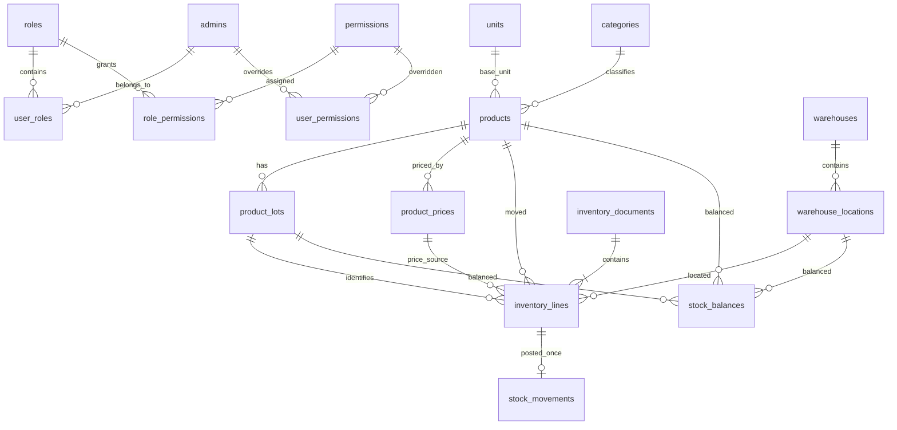

# Đề xuất mở rộng hệ thống quản lý sản phẩm thành hệ thống kho

Tài liệu này là đặc tả cho bài thực hành PHP thuần + PDO + MySQL. Mục tiêu là cho sinh viên thấy một luồng nhập xuất hoàn chỉnh, hiểu quyền được kiểm tra ở đâu và tiếp tục phát triển trên một mô hình dữ liệu có thể kiểm chứng.

## 1. Phạm vi và nguyên tắc

| Nội dung | Quyết định của khung mẫu |
|---|---|
| Sản phẩm | Lưu thông tin danh mục, SKU, đơn vị cơ sở, mức tồn tối thiểu; không lưu số lượng tồn hoặc đơn giá hiện hành |
| Tồn kho | Theo bộ ba sản phẩm + vị trí kho + lô; cập nhật qua phiếu đã ghi sổ |
| Giá | Bảng lịch sử riêng; phân biệt giá nhập (`purchase`) và giá xuất (`sale`) |
| Người dùng | Tận dụng bảng `admins` hiện có như bảng tài khoản; bổ sung nhóm, quyền nhóm và quyền riêng |
| Chứng từ | Phiếu nhập, phiếu xuất nội bộ; nhiều dòng hàng; nháp → đã ghi sổ hoặc nháp → đã hủy |
| In | Chỉ in phiếu đã ghi sổ; đây là phiếu kho nội bộ, không phải hóa đơn thuế |
| Số lượng | Số nguyên dương theo đơn vị cơ sở của sản phẩm; quy đổi đơn vị là bài tập tiếp theo |
| Giá trị tồn | Chưa tính giá vốn; không dùng giá bán hiện hành nhân tồn kho để trình bày như giá trị kế toán |

Luồng mẫu:

```text
Khai báo đơn vị, kho/vị trí, sản phẩm, lô
             ↓
Thiết lập giá có khoảng hiệu lực
             ↓
Tạo phiếu NHÁP và chụp đơn giá vào từng dòng
             ↓
Kiểm tra quyền ghi sổ + trạng thái + số lượng khả dụng
             ↓
Ghi sổ trong một transaction → sổ biến động + số dư + trạng thái
             ↓
Xem tồn kho / dashboard / in phiếu
```

## 2. Mô hình dữ liệu

### 2.1. Tài khoản và phân quyền

`UserPermission` là khái niệm nghiệp vụ; bảng dùng tên `user_permissions` theo quy ước của dự án.

| Bảng | Vai trò và khóa đáng chú ý |
|---|---|
| `admins` | Tài khoản đăng nhập hiện có; `id` là `user_id` ở các bảng liên kết |
| `roles` | Nhóm quyền: quản trị, thủ kho, người lập phiếu, người xem báo cáo… |
| `permissions` | Mỗi mã biểu diễn một hành động cụ thể, ví dụ `issues.post` |
| `user_roles` | Nhiều nhóm cho một tài khoản; khóa duy nhất `(user_id, role_id)` |
| `role_permissions` | Quyền được cấp cho nhóm; khóa duy nhất `(role_id, permission_id)` |
| `user_permissions` | Ngoại lệ riêng của tài khoản; `effect = allow / deny`; khóa duy nhất `(user_id, permission_id)` |

Tên nhóm không tạo quyền tự động. Tài khoản thuộc nhóm `admin` vẫn phải nhận các quyền qua dữ liệu `role_permissions`; không có điều kiện đặc biệt kiểu `username === 'admin'` để bỏ qua kiểm tra.

### 2.2. Kho và sản phẩm

| Bảng | Trường nghiệp vụ chính |
|---|---|
| `units` | Mã, tên đơn vị cơ sở: cái, hộp, chiếc… |
| `warehouses` | Mã kho, tên kho |
| `warehouse_locations` | Kho, mã vị trí, khu (`zone`), kệ (`rack`), ô (`bin`) |
| `products` | SKU, tên, danh mục, `unit_id`, `min_stock`, trạng thái |
| `product_lots` | Sản phẩm, mã lô, ngày hết hạn tùy chọn |
| `product_prices` | Sản phẩm, loại giá, số tiền, thời điểm bắt đầu/kết thúc hiệu lực |
| `stock_balances` | Khóa `(product_id, location_id, lot_id)` và số lượng hiện tại |
| `stock_movements` | Biến động có dấu, tham chiếu phiếu và dòng phiếu; mỗi dòng chỉ được ghi một lần |

Lô hàng là lô sản phẩm, không phải vị trí vật lý. Ví dụ lô `LO-2026-11` của sản phẩm A có thể nằm ở hai ô kho. Trong khung mẫu, sản phẩm không theo dõi lô đặc biệt vẫn dùng một lô mặc định `NOLOT` để tránh khóa tồn có giá trị `NULL`.

Một đơn vị là đơn vị đếm cơ sở của sản phẩm. Không cộng “5 cái” với “3 kg” thành một chỉ số có ý nghĩa nghiệp vụ; dashboard và báo cáo cần đọc số lượng theo đơn vị. Khi bổ sung quy đổi, phải định nghĩa hệ số và quy tắc làm tròn trước khi thay đổi kiểu số lượng.

### 2.3. Phiếu

| Bảng | Vai trò |
|---|---|
| `inventory_documents` | Số phiếu duy nhất, loại nhập/xuất, ngày phiếu, đối tác, ghi chú, trạng thái, người lập, người/thời điểm ghi sổ |
| `inventory_lines` | Sản phẩm, vị trí, lô, số lượng, đơn vị, `price_id`, đơn giá đã chụp; kèm tên sản phẩm/SKU/tên đơn vị/nhãn vị trí/mã lô tại lúc lập phiếu |

Mỗi dòng mang vị trí riêng; một phiếu mẫu có thể có hàng ở nhiều vị trí/kho. Nếu bài toán yêu cầu “một phiếu chỉ thuộc một kho”, sinh viên phải bổ sung `warehouse_id` ở đầu phiếu và kiểm tra tất cả vị trí thuộc kho đó. Đơn vị cơ sở của sản phẩm không được đổi sau khi sản phẩm đã có dòng phiếu, kể cả phiếu nháp; sản phẩm mới tự có lô `NOLOT`.



## 3. Phân quyền: nhóm + ngoại lệ tài khoản

### 3.1. Quy tắc quyết định

Với người dùng U và quyền P, kiểm tra theo đúng thứ tự:

1. Có `user_permissions(U,P,deny)` → từ chối.
2. Có `user_permissions(U,P,allow)` → cho phép.
3. Có ít nhất một nhóm của U cấp P → cho phép.
4. Không có trường hợp nào ở trên → từ chối mặc định.

```php
function permission_decision($directEffect, $grantedByAnyGroup): bool {
    if ($directEffect === 'deny') return false;
    if ($directEffect === 'allow') return true;
    return $grantedByAnyGroup;
}
```

“Kế thừa” trên giao diện nghĩa là xóa ngoại lệ riêng và quay lại kết quả từ nhóm. Không đồng nghĩa với “cho phép”. Nhóm chỉ chứa quyền cấp; việc cấm đặc biệt nằm ở tài khoản, tránh xung đột “nhóm A cấm, nhóm B cấp” chưa được định nghĩa.

Ví dụ: Lan thuộc nhóm Thủ kho có `issues.post`. Nếu Lan được gán riêng `issues.post = deny`, Lan không thể ghi sổ phiếu xuất dù giao diện hay request trực tiếp. Khi bỏ ngoại lệ này về “Kế thừa”, quyền từ nhóm có hiệu lực lại.

### 3.2. Danh mục quyền

| Quyền | Hành động |
|---|---|
| `dashboard.view` | Xem dashboard tổng quan |
| `products.view`, `products.manage` | Xem; tạo/sửa/xóa thông tin sản phẩm |
| `categories.view`, `categories.manage` | Xem; quản lý danh mục sản phẩm |
| `inventory.view` | Xem số dư tồn và cảnh báo |
| `warehouse.manage` | Khai báo đơn vị, kho, vị trí, lô |
| `prices.view`, `prices.manage` | Xem; khai báo lịch sử giá |
| `documents.view` | Xem danh sách và chi tiết phiếu |
| `receipts.create`, `receipts.post` | Lập/hủy nháp nhập; ghi sổ nhập |
| `issues.create`, `issues.post` | Lập/hủy nháp xuất; ghi sổ xuất |
| `documents.print` | In phiếu đã ghi sổ |
| `access.manage` | Quản lý nhóm và ngoại lệ quyền người dùng |

Quyền xem và quyền thay đổi là các mã độc lập. Khi cấp nhóm cho một công việc, cần cấp cả quyền xem liên quan để người dùng đi được hết luồng giao diện. Người dùng có quyền lập phiếu chưa đương nhiên có quyền ghi sổ. Quyền in cũng không thay cho quyền xem phiếu.

### 3.3. Ma trận nhóm gợi ý cho bài tập

Đây là cấu hình nghiệp vụ gợi ý để giảng viên tạo trong màn hình phân quyền; không mặc định coi các nhóm này đã có đủ tài khoản mẫu.

| Chức năng | Quản trị | Người lập phiếu | Thủ kho | Người xem |
|---|---|---|---|---|
| Xem sản phẩm / giá / phiếu | Có | Có | Có | Có |
| Xem dashboard / tồn kho | Có | Có | Có | Có |
| Lập nhập / xuất | Có | Có | Tùy quy trình | Không |
| Ghi sổ nhập / xuất | Có | Không | Có | Không |
| In phiếu đã ghi sổ | Có | Có | Có | Tùy nhu cầu |
| Quản lý danh mục / kho / giá | Có | Không | Tùy nhiệm vụ | Không |
| Quản lý phân quyền | Có | Không | Không | Không |

Việc giấu nút chỉ giúp người dùng hiểu giao diện. Server phải gọi `require_permission()` ở route và kiểm tra lại trong nghiệp vụ nhạy cảm. Không nhận danh sách quyền từ hidden input, JavaScript hoặc session đã cũ làm bằng chứng cấp quyền. Form thay đổi dữ liệu phải kiểm tra phương thức POST và CSRF.

Khung mẫu phân quyền theo chức năng toàn hệ thống. Quyền theo kho, người lập chỉ xem phiếu của mình, người lập không được tự duyệt và nhật ký thay đổi quyền là các yêu cầu mở rộng riêng.

## 4. Giá theo thời gian

Mỗi dòng giá có `product_id`, `price_type`, `amount`, `valid_from`, `valid_to`. Khoảng hiệu lực là nửa kín `[valid_from, valid_to)`: tính thời điểm bắt đầu, không tính thời điểm kết thúc; `valid_to = NULL` nghĩa là chưa có thời điểm kết thúc.

Ví dụ:

| Sản phẩm | Loại | Từ | Đến | Giá |
|---|---|---|---|---:|
| SP01 | sale | 01/11/2026 00:00 | 15/11/2026 00:00 | 120.000 |
| SP01 | sale | 15/11/2026 00:00 | Không giới hạn | 130.000 |

Phiếu tại đúng 15/11/2026 00:00 lấy 130.000. Giá nhập và giá xuất có thể cùng hiệu lực vì là hai loại giá khác nhau.

Quy tắc:

- Mức giá không âm; giá 0 là cấu hình hợp lệ có chủ ý, khác với “không tìm thấy giá”.
- `valid_to` nếu có phải lớn hơn `valid_from`.
- Cùng sản phẩm và loại giá không có hai khoảng giao nhau. Hai khoảng tiếp giáp được phép.
- Chọn giá nhập cho phiếu nhập, giá xuất cho phiếu xuất theo ngày giờ của phiếu.
- Không tìm được giá → không tạo phiếu; không ngầm dùng 0 hay giá từ `products`.
- Server tự lấy giá và lưu `price_id`, `unit_price` vào dòng; bỏ qua mọi đơn giá giả mạo từ trình duyệt.
- Đơn giá được chụp khi lập nháp và giữ nguyên khi ghi sổ. Đây là lựa chọn của bài mẫu; không có bước tự đổi giá khi bấm ghi sổ.
- Tổng dòng = số lượng × đơn giá đã chụp; tổng phiếu = tổng các dòng. Mẫu không tính thuế, chiết khấu hoặc công nợ.

Mẫu chỉ thêm mới khoảng giá, không sửa/xóa khoảng đã lưu. Nếu một khoảng có `valid_to = NULL`, mọi khoảng mới về sau cùng loại sẽ giao với nó và bị từ chối. Muốn thử nhiều mức giá liên tiếp, phải chọn ngày kết thúc hữu hạn ngay khi tạo từng khoảng. Giá chuyển đổi từ database cũ là khoảng mở, nên sản phẩm cũ chưa thể lập mức giá kế tiếp bằng giao diện mẫu.

Quy trình khóa và kết thúc khoảng đang mở rồi tạo khoảng mới trong một transaction là bài tập phát triển tiếp. Khung mẫu khóa sản phẩm khi kiểm tra/thêm giá để hai request không cùng tạo khoảng chồng nhau. Chỉnh sai giá đã dùng phải giữ nguyên giá chụp trên chứng từ. Dữ liệu ngày giờ phải dùng cùng múi giờ ứng dụng và database; cần thử trường hợp biên trước khi triển khai nhiều múi giờ.

## 5. Business rule của phiếu nhập, xuất

### 5.1. Trạng thái

| Trạng thái hiện tại | Hành động | Kết quả | Tác động tồn |
|---|---|---|---|
| Chưa có | Lập phiếu | `draft` | Không |
| `draft` | Ghi sổ đủ điều kiện | `posted` | Nhập cộng; xuất trừ |
| `draft` | Hủy | `cancelled` | Không |
| `posted` | Ghi sổ lần nữa | Từ chối | Không ghi thêm |
| `posted` | Sửa/xóa/hủy trực tiếp | Không cho phép | Không |
| `cancelled` | Ghi sổ | Từ chối | Không |

Mẫu không sửa nội dung phiếu nháp: hủy nháp và lập lại. Phiếu đã ghi sổ chỉ được sửa sai bằng quy trình đảo/điều chỉnh ở bài tập nâng cao, có liên kết phiếu gốc. Không xóa dòng sổ biến động để “sửa tồn”.

### 5.2. Điều kiện và xử lý

| Mã | Quy tắc nghiệp vụ |
|---|---|
| BR01 | Người dùng đã đăng nhập và có quyền phù hợp với loại phiếu/hành động |
| BR02 | Phiếu có ít nhất một dòng; ngày giờ hợp lệ và không ở tương lai |
| BR03 | Sản phẩm, vị trí, lô, đơn vị tồn tại; lô phải thuộc đúng sản phẩm; sản phẩm dùng đơn vị cơ sở đã khai báo |
| BR04 | Số lượng là số nguyên dương, không nhận 0, số âm, số thập phân hoặc dữ liệu không phải số |
| BR05 | Mọi dòng có giá đúng loại đang hiệu lực tại ngày phiếu; chụp giá tại server |
| BR06 | Nhiều dòng cùng sản phẩm/vị trí/lô phải được xét tổng số lượng khi kiểm tra xuất |
| BR07 | Xuất chỉ được ghi sổ nếu số dư của từng bộ khóa đủ; không cho âm tồn |
| BR08 | Lô xuất không được quá hạn tại ngày phiếu và tại lúc ghi sổ; không dùng ngày lùi để xuất hàng đã quá hạn |
| BR09 | Phiếu phải đang `draft` mới ghi sổ hoặc hủy; số phiếu duy nhất |
| BR10 | Ghi sổ cập nhật số dư, sổ biến động và đầu phiếu trong cùng transaction; một dòng lỗi thì rollback toàn phiếu |
| BR11 | Khóa đầu phiếu và các khóa tồn liên quan khi ghi sổ; khóa tồn theo thứ tự ổn định; mỗi dòng có tối đa một biến động |
| BR12 | Phiếu đã ghi sổ giữ nguyên dòng hàng, số lượng, đơn giá; chỉ phiếu đã ghi sổ được in chính thức |

Lùi ngày phiếu không tái tạo tồn khả dụng trong quá khứ: mẫu kiểm tra số dư hiện tại tại lúc ghi sổ. Nếu cần sổ tồn theo ngày hoặc khóa kỳ, phải quy định thêm ngày nghiệp vụ/ngày ghi sổ và cách kiểm tra tồn lịch sử.

### 5.3. Ví dụ luồng

Nhập 10 cái SP01 tại kho MAIN, ô A/K1/O1, lô L01 với đơn giá nhập 80.000. Lưu nháp chưa đổi tồn. Ghi sổ thành công tạo biến động +10 và số dư 10.

Lập phiếu xuất 6 cái cùng khóa tồn, đơn giá xuất 120.000. Ghi sổ còn 4. Một phiếu xuất khác yêu cầu 5 phải thất bại; mọi dòng của phiếu đó giữ nguyên nháp và không có biến động được tạo.

Nếu hai người đồng thời xuất 4 từ số dư 4, chỉ một phiếu được ghi sổ. Phiếu còn lại phải nhận lỗi thiếu tồn sau khi đọc số dư đã khóa. Chỉ kiểm tra số lượng khi mở form là chưa đủ.

## 6. Giao diện mẫu cho từng chức năng

Các khung dưới đây mô tả thông tin bắt buộc và thứ tự thao tác. Route chính: `/products`, `/warehouse-catalog`, `/prices`, `/inventory`, `/documents`, `/dashboard`, `/access`; chi tiết phương thức và route thao tác xem `README.md` và router của dự án.

### 6.1. Danh sách sản phẩm có phân trang

```text
SẢN PHẨM                                   [+ Thêm sản phẩm]
[Tên/SKU________] [Danh mục ▼] [Số dòng ▼] [Tìm]
Ảnh | Tên / SKU | Danh mục | Đơn vị | Tồn tối thiểu | Trạng thái | Thao tác
...
Hiển thị 1–10 / 83                            [Trước] 1 2 3 ... [Sau]
```

Đổi bộ lọc về trang 1; chuyển trang giữ bộ lọc. Đếm tổng với cùng điều kiện tìm kiếm; dùng `LIMIT/OFFSET` phía database, không tải toàn bảng rồi cắt bằng PHP. Trang quá lớn được đưa về trang cuối hợp lệ; thứ tự ổn định có khóa `id`.

Form sản phẩm có đơn vị cơ sở và mức tồn tối thiểu, không có ô nhập giá hoặc sửa tồn. Thêm hàng bằng phiếu nhập; xem giá ở màn hình lịch sử giá.

### 6.2. Danh mục kho, vị trí, lô, đơn vị

```text
DANH MỤC KHO
[Đơn vị] Mã, Tên                             [Thêm]
[Kho] Mã, Tên                                [Thêm]
[Vị trí] Kho ▼, Mã, Khu, Kệ, Ô               [Thêm]
[Lô] Sản phẩm ▼, Mã lô, Hết hạn (tùy chọn)   [Thêm]
Các bảng danh mục hiện có, mã và quan hệ tương ứng
```

Mẫu ưu tiên khai báo thêm. Dòng phiếu lưu thông tin chụp để tên sản phẩm, đơn vị, vị trí và mã lô trên phiếu lịch sử không đổi theo dữ liệu danh mục. Sửa/xóa danh mục đã được dùng vẫn cần chính sách tham chiếu và tính nhất quán tồn; sinh viên bổ sung ngừng sử dụng thay vì xóa dữ liệu có tham chiếu.

Màn hình `/warehouse-catalog` dùng tham số `tab=warehouses|locations|lots|units` để chọn danh mục; cùng route xử lý GET xem và POST tạo mới.

### 6.3. Lịch sử giá

```text
GIÁ THEO THỜI GIAN
Sản phẩm ▼ | Loại nhập/xuất ▼ | Giá | Từ ngày giờ | Đến ngày giờ | [Lưu]
Sản phẩm | Loại giá | Đơn giá | Từ | Đến | Người tạo
```

Màn hình `/prices` xử lý GET xem lịch sử và POST thêm khoảng giá. Hiển thị rõ `Không giới hạn` khi chưa có ngày kết thúc; báo lỗi khi chồng khoảng. Form phiếu không cho người dùng tự thay đơn giá đã tra cứu. Giao diện mẫu chưa có thao tác đóng khoảng giá đang mở.

### 6.4. Danh sách, lập, xem và in phiếu

```text
PHIẾU NHẬP XUẤT                       [+ Nhập] [+ Xuất]
[Tìm số phiếu/đối tác] [Loại ▼] [Trạng thái ▼] [Lọc]
Số phiếu | Ngày | Loại | Đối tác | Trạng thái | Xem
                                               [Phân trang]

LẬP PHIẾU NHẬP / XUẤT
Ngày giờ | Đối tác | Ghi chú
Sản phẩm ▼ | Vị trí ▼ | Lô ▼ | Số lượng
... nhiều dòng ...
[Lưu nháp]

CHI TIẾT PHIẾU
Số phiếu + trạng thái + người lập/ghi sổ
Sản phẩm | Vị trí | Lô | Đơn vị | SL | Giá chụp | Thành tiền
Tổng tiền
Nháp: [Ghi sổ] [Hủy nháp]     Đã ghi sổ: [In phiếu]
```

Màn hình in có tiêu đề phiếu nhập/xuất kho nội bộ, số phiếu, ngày, đối tác, dòng hàng, tổng tiền và vị trí ký giao/nhận. CSS in ẩn sidebar, nút và bộ lọc. Tiền in lấy từ dòng phiếu, không tra lại bảng giá hiện hành.

### 6.5. Tồn kho và dashboard

```text
DASHBOARD TỒN KHO
Số mã sản phẩm | Số kho | Sản phẩm chạm/dưới ngưỡng | Phiếu nháp
Tồn theo kho / theo đơn vị
Danh sách chạm hoặc dưới mức tồn tối thiểu
Phiếu gần đây

CHI TIẾT TỒN
[Sản phẩm/SKU] [Kho ▼] [Lọc]
Sản phẩm | Kho | Khu/Kệ/Ô | Lô | Hết hạn | Đơn vị | Tồn
                                                   [Phân trang]
```

Tồn tối thiểu ở mẫu là ngưỡng tổng sản phẩm toàn hệ thống, chưa phải ngưỡng riêng cho từng kho. Cảnh báo khi tồn nhỏ hơn hoặc bằng ngưỡng (`<= min_stock`), xét cả sản phẩm chưa có dòng số dư để hiện tồn 0. Chỉ số số lượng tổng hợp phải ghi rõ theo đơn vị; chưa trình bày giá trị tồn kế toán khi chưa có phương pháp giá vốn.

### 6.6. Phân quyền

```text
PHÂN QUYỀN
Người dùng ▼ → Các nhóm [✓] [ ] ...
Mã quyền | Kế thừa / Cho phép / Từ chối | Kết quả hiện tại
[Lưu quyền tài khoản]

Nhóm ▼ → Danh sách quyền [✓] [ ] ...
[Lưu quyền nhóm]
```

Thông báo ngay trên form: “Từ chối riêng ưu tiên cao nhất; kế thừa áp dụng hợp các quyền từ nhóm”. Giới hạn thao tác khiến người quản trị tự mất quyền quản lý phải được kiểm tra phía server. Người dùng không có `access.manage` không xem được hoặc gửi POST thay đổi cấu hình quyền.

## 7. Chuyển đổi dữ liệu và lộ trình

Không xóa volume để nâng cấp database đang có dữ liệu. Sao lưu trước, chạy migration một lần trên bản sao, đối soát rồi mới áp dụng môi trường chính.

- Tạo bảng quyền, kho, đơn vị, lô, giá và chứng từ trước.
- Chuyển `products.unit_price` cũ thành lịch sử giá nhập/xuất ban đầu; đây là giả định chuyển đổi cần xác nhận với chủ dữ liệu, không khẳng định giá cũ là giá vốn.
- Chuyển `products.quantity` cũ thành phiếu nhập số dư đầu đã ghi sổ, với dòng biến động và số dư tương ứng.
- Giữ bản chụp `legacy_product_stock_prices` để đối chiếu số lượng và đơn giá gốc.
- Đối soát tổng tồn và số lượng theo từng SKU; kiểm tra người dùng quản trị còn đủ quyền.
- Sau khi lưu dữ liệu thay thế, bỏ cột tồn/giá khỏi `products` để tránh hai nguồn dữ liệu cạnh tranh.

Migration chỉ chạy một lần; MySQL DDL tự commit nên lỗi giữa chừng không tự rollback toàn script, không chạy lại mù quáng. Môi trường cài mới dùng `database/init.sql`; môi trường cũ dùng script migration có trong thư mục `database/migrations`. Tài khoản `admins` cũ được gán nhóm ADMIN để giữ khả năng quản trị vốn có; cần rà lại nhóm và tách quyền sau chuyển đổi. Các tài khoản demo clerk/manager/viewer chỉ được tạo ở cài mới, không được thêm vào database cũ bởi migration.

Lộ trình dạy học:

1. Phân tích dữ liệu, phân trang thực, truy vấn tham số hóa.
2. Xây RBAC và thử các request bị cấm.
3. Khai báo kho/lô/đơn vị, giá theo thời gian.
4. Lập nháp, ghi sổ, đối soát sổ biến động với số dư, in phiếu.
5. Sinh viên nhận một yêu cầu nâng cao, viết quy tắc và kiểm thử trước khi mở rộng.

Danh sách bài tập, tiêu chí nghiệm thu và cách chấm nằm ở [BAI_TAP_SINH_VIEN.md](BAI_TAP_SINH_VIEN.md).
